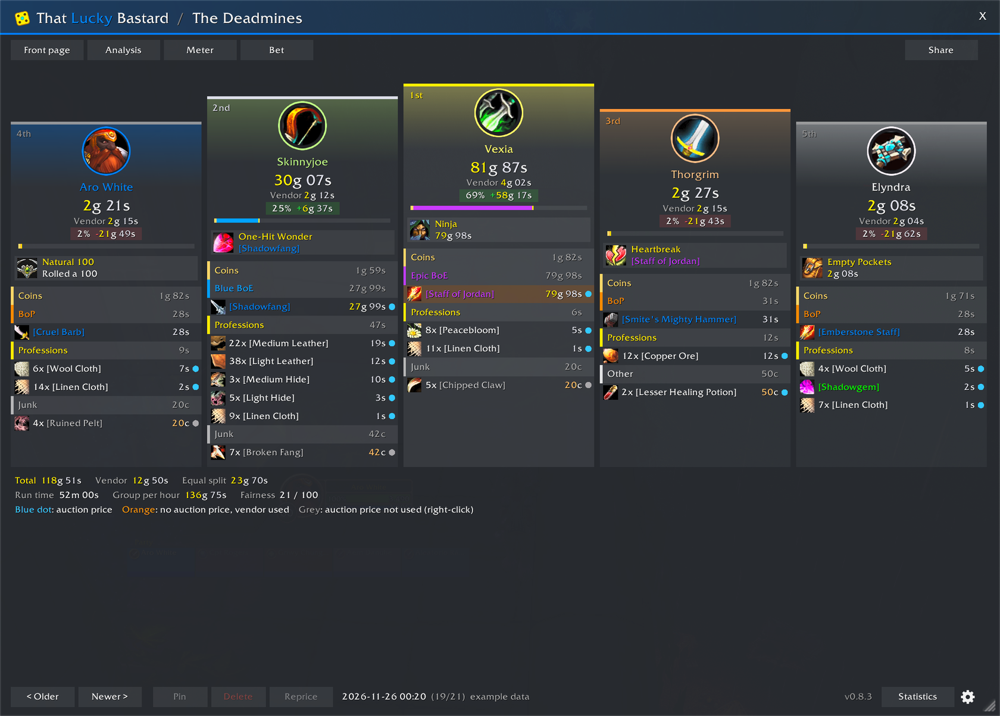
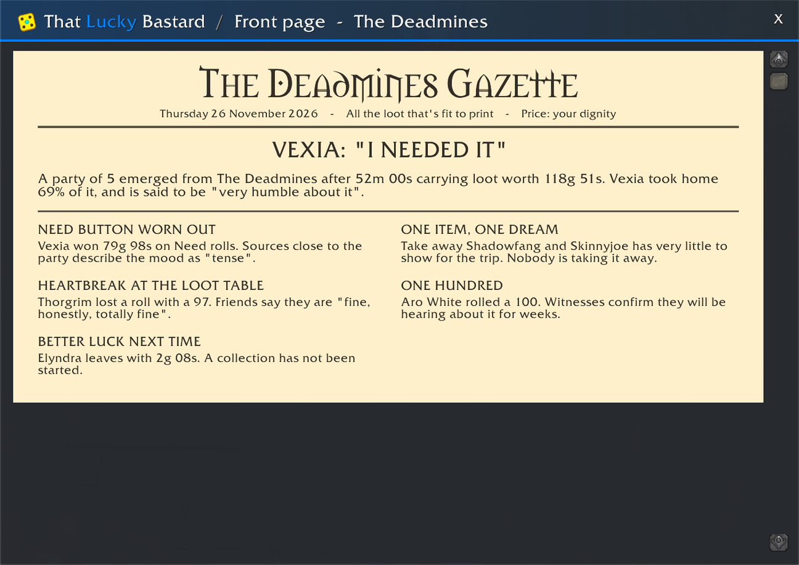
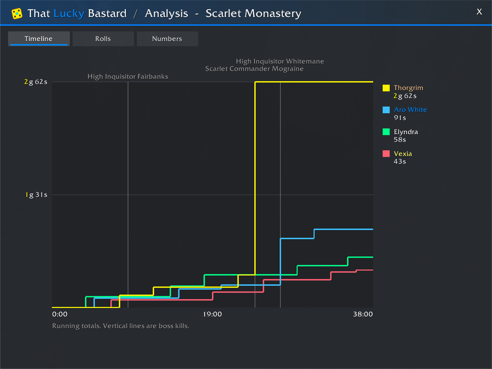
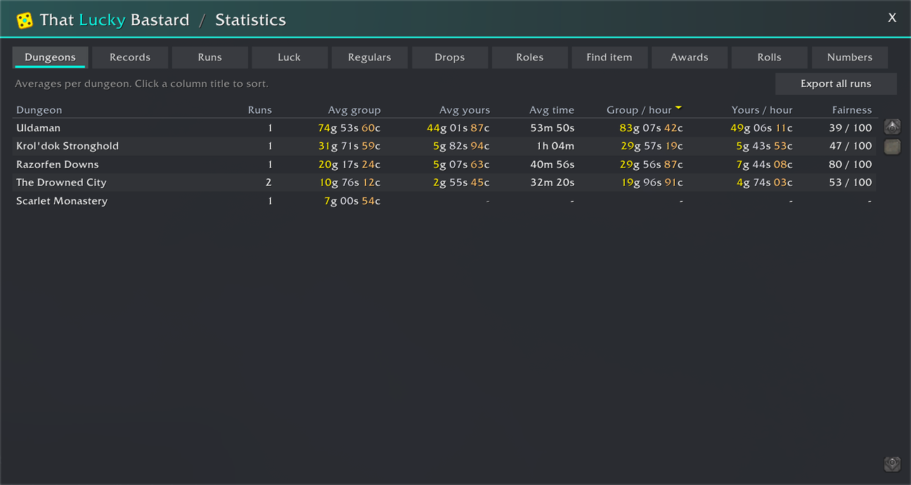
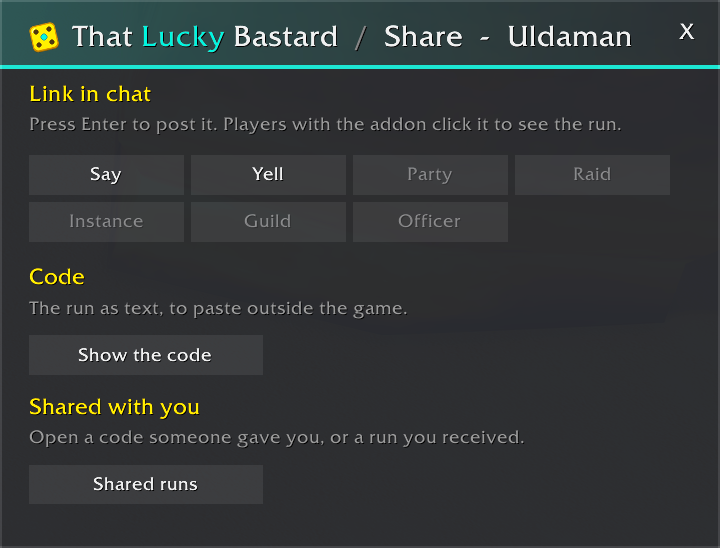

# That Lucky Bastard

A World of Warcraft addon for **WoW Forever** that shows who got what in a dungeon run, and who got lucky.

It records what every player in your group loots, puts a gold value on it, and shows the result when you leave the dungeon. It never sends a chat message on its own: what it shows stays on your screen unless you share a run.

## What you get

- **The breakdown:** each player's total, their share of the run and how far they are from an equal split, with every item they looted.
- **Awards:** one per player when the run ends, out of about fifty: Jackpot, Ninja, Luckiest, Heartbreak, Empty Pockets... In raids an award can go to two or three players. Hover one to see its rule.
- **Need rolls:** one button shows only what was won on Need. Hover an item to see everyone's roll on it.
- **The race:** as you leave, every player's loot falls into their column as coins. The last stack still growing has won, and a winner far ahead overflows.
- **Front page, analysis:** a mock newspaper, and the run's timeline, rolls and numbers, each in its own window.
- **The meter:** a small window like a damage meter, with a bar per player that grows live as the loot comes in.
- **Statistics:** your dungeons, records, luck, the people you run with and what dropped where, with item search and an export for spreadsheets.
- **While you play:** notices for valuable loot and familiar faces, one line in player and item tooltips, and a private loot bingo card to bet a line on.
- **Sharing:** post a run as a link in chat or as a short summary anyone can read, or copy it as a code to paste anywhere. Players with the addon open links and codes.

|  |  |
| --- | --- |
|  |  |

## How loot is valued

- Vendor prices come from the game. Auction prices come from [Auctionator](https://www.curseforge.com/wow/addons/auctionator) or TradeSkillMaster, if you have one of them.
- Bind on Pickup, quest and grey items count at vendor price.
- A blue dot marks an auction price. Right-click an item to switch between its auction and vendor price.

## Install and use

1. Put the `ThatLuckyBastard` folder in the Forever client's `Interface\AddOns` folder.
2. Restart the game or type `/reload`.

A run starts when you enter a dungeon, and the window opens when you leave it alive.

| Command | Effect |
| --- | --- |
| `/tlb` | Open or close the window |
| `/tlb options` | Open the options |
| `/tlb help` | List every command |

The minimap button does the same: left-click for the window, right-click for the options.

## Good to know

- The game only reports another player's loot when you are close to them. Loot picked up far away is missed.
- Coin, quest rewards, trades and crafted items are not counted.
- Auction prices are taken as they are, so one unrealistic listing can distort a run.
- Built for WoW Forever (interface 16001). The addon's text is in English only.

## More

- [Details](https://github.com/Dreskn/ThatLuckyBastard/blob/main/DETAILS.md): every page, option, command and limit, and how to move over from FairShare, the addon's name until 0.2.2.
- [Changelog](https://github.com/Dreskn/ThatLuckyBastard/blob/main/CHANGELOG.md)
- [MIT license](https://github.com/Dreskn/ThatLuckyBastard/blob/main/LICENSE)
